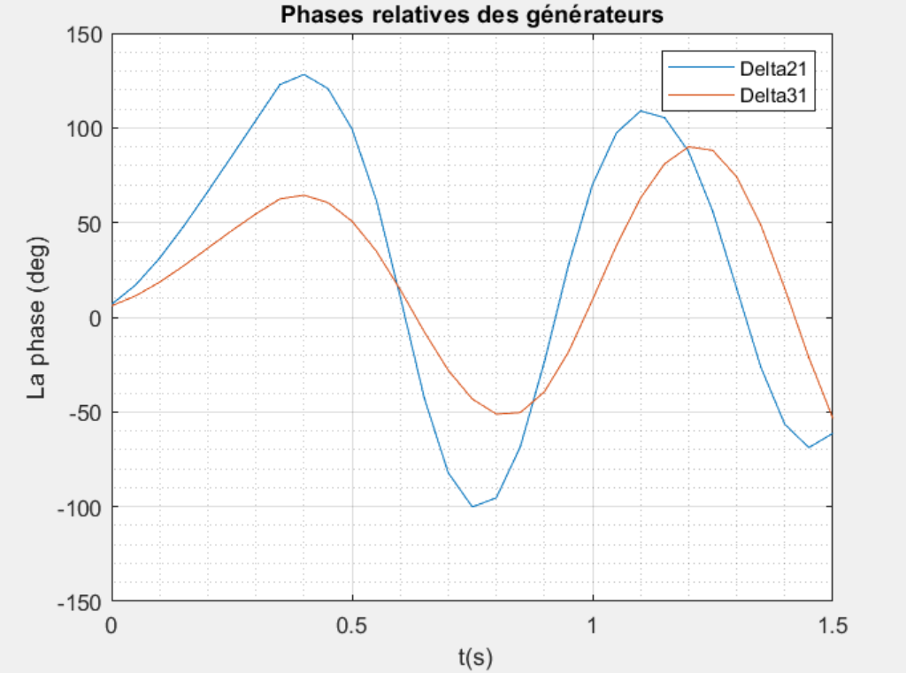
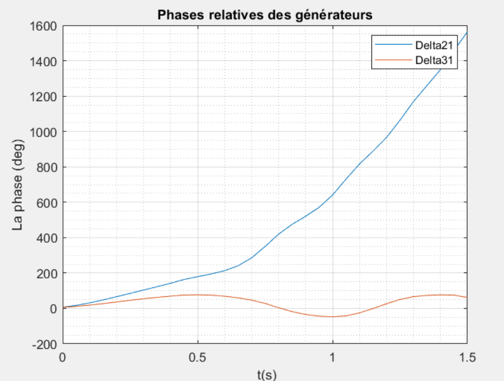

# Power Flow and Network Analysis

A MATLAB application for studying power flow and transient stability in electrical networks. It combines network-matrix construction, steady-state solvers and generator-response visualization.

## What it does

- Builds bus admittance and impedance matrices.
- Solves power flow using Gauss-Seidel, Newton-Raphson and Fast Decoupled Load Flow.
- Explores generator rotor-angle behavior after a network disturbance.
- Provides example networks from small teaching systems to larger bus configurations.

## Results

Figures from the [technical report](docs/power-flow-analysis-report.pdf) show the influence of fault-clearing time on generator dynamics in the six-bus study.

### Fault cleared at 0.4 seconds



### Fault cleared at 0.5 seconds



## Tools

MATLAB, numerical linear algebra, iterative power-flow methods and time-domain simulation.

## Run

Open this folder in MATLAB and run:

```matlab
power_flow_app
```

Select a network, configure its data and choose an analysis method.

## Project files

| File | Purpose |
| --- | --- |
| `power_flow_app.m` | Application entry point |
| `Gauss_Seidel.m`, `Newton_Raphson.m`, `FDLF.m` | Power-flow solvers |
| `Y_bus.m`, `Z_bus.m` | Network matrices |
| `st.m` | Transient-stability study |
| `system*.m` | Example bus systems |

Developed as a collaborative academic engineering project.
